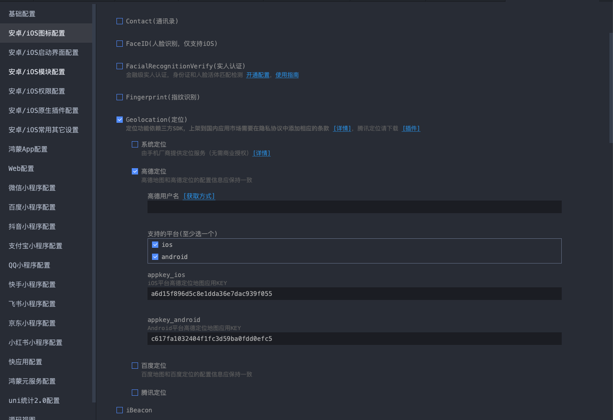
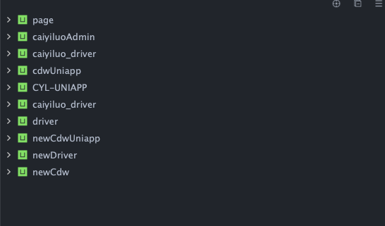
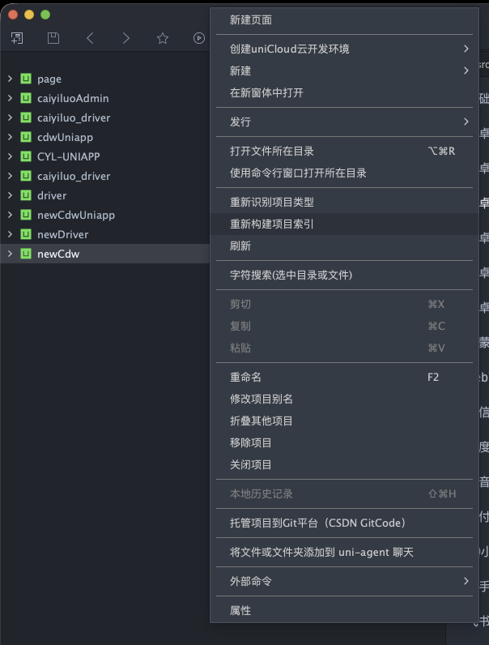
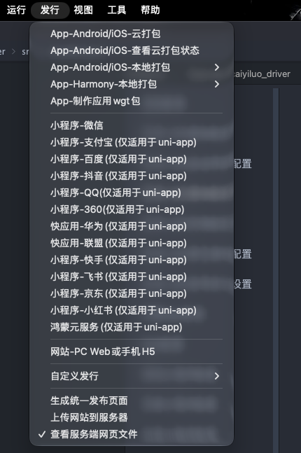
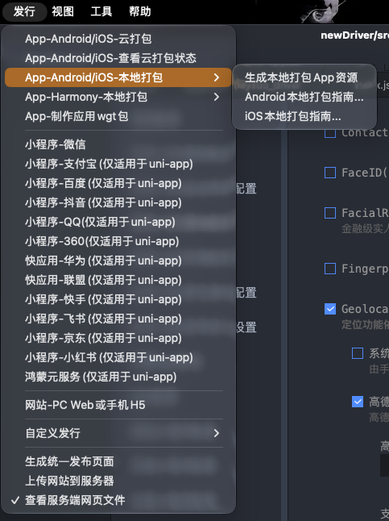
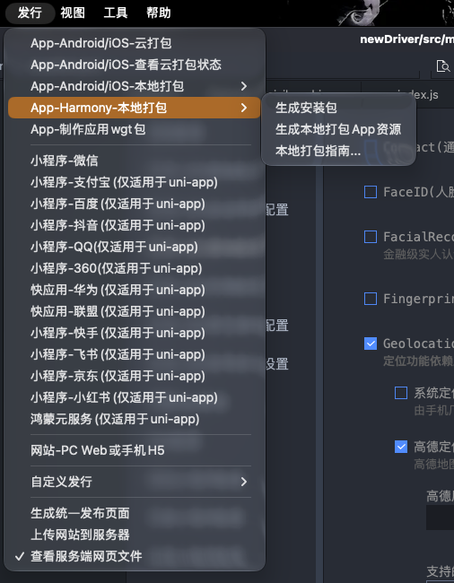
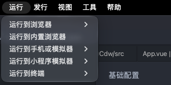
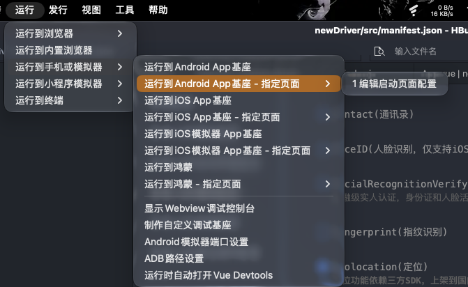
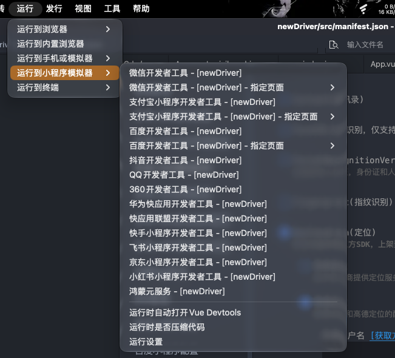

你知道hbuilder吗？ 我想要写一个 tui， 控制
能查看, 添加以及移除（不是删除哦）
发行  等等
运行 等等

## 已确认的需求范围

- 项目操作：覆盖 HBuilderX 项目右键菜单中的操作，不限于查看、添加和移除。包括新建页面、创建 uniCloud 云开发环境、新建、在新窗体中打开、发行、打开所在目录、使用命令行窗口打开所在目录、重新识别项目类型、重新构建项目索引、刷新、字符搜索、剪切、复制、粘贴、重命名、修改项目别名、折叠其他项目、移除项目、关闭项目、本地历史记录、托管项目到 Git 平台、将文件或文件夹添加到 uni-agent 聊天、外部命令、属性，以及菜单中的子操作。
- 移除项目不等于删除磁盘上的项目文件。
- 配置：覆盖 HBuilderX manifest.json 配置界面的全部配置及其操作，不限于常用字段或文本编辑；包含各平台配置、原生插件选择等。
- 运行与发行：与 HBuilderX 支持的目标及相关操作对齐，不缩减为部分平台。
- 交互约束：用户不需要打开 HBuilderX；不允许将必要操作转交 HBuilderX 或其他外部图形界面完成，操作入口与交互保留在 TUI。
- 宿主系统：支持 macOS、Windows、Linux。
- 待明确：是否允许依赖已安装的 HBuilderX 编译器或后台服务但不显示图形界面，以及是否要求完全不安装 HBuilderX；对齐的 HBuilderX 版本与各宿主系统的实际能力需核实。

## CLI 能力调查

已核实官方 CLI 文档和本机 5.24.2026081301 的只读命令，见 [CLI 能力与需求对照](cli-capabilities.md)。CLI 已覆盖大量运行、发行、日志和云能力，但不能将其视为全部项目菜单与全部 manifest 配置操作的等价 API；三端完全无 GUI 的端到端能力尚未验证。需求范围保持不变。

## 当前实现范围

用户已同意先完成已确认可实现的部分，暂缓上述无可靠接口或需要外部 GUI／远端授权的缺口。实现与运行方式见 [README](../README.md)。

技术栈最终确定为 **仅 Bun + TypeScript + OpenTUI**，保留 macOS、Windows、Linux 目标；不再保留 Python 或 Node.js 运行入口。

已落地独立项目列表、受限文件管理、22 类配置入口及扩展字段编辑、保留注释的保存、图标生成与手动图标校验、启动资源校验／storyboard 生成、本地原生插件导入，以及按安装版本发现的 CLI 命令、参数、日志和取消。工作台列表的移除／别名不冒充 HBuilderX 内部元数据操作；仅编译不冒充实际运行。

验证使用临时项目与隔离子进程，真实 CLI 仅执行帮助、版本和项目列表。Bun 版已在 macOS arm64 执行原生渲染、配置键盘编辑／保存、打包安装、真实 PTY 退出及进程树取消检查。没有对业务项目执行构建、打包、上传或资源修改；Windows／Linux 已配置 CI，实机及各平台真实发行仍未验证。
